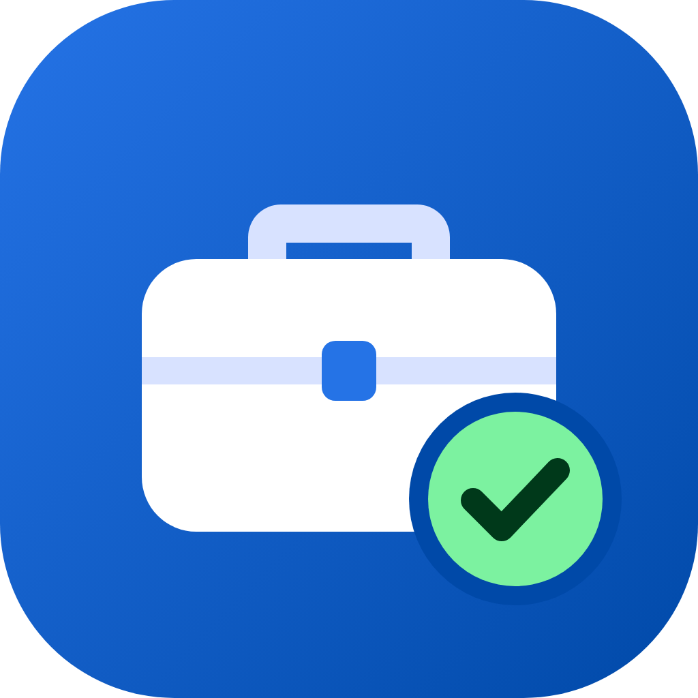

# Auto Job Hunt

A Claude plugin that runs your job search for you. No tech skills needed.

- Asks you a few questions and reads your resume.
- Finds jobs on about 100 companies (tech, tech sales, sales, and the Tata group such as Tanishq, Croma and Westside), Naukri and LinkedIn.
- Scores each job against what you want and skips the ones that do not fit.
- Writes a cover letter and a job-specific resume when a job needs one, using only facts from your resume.
- Applies for you, slowly and safely, after you say yes (or right away, if you turn that on).
- Shows everything on a dashboard in your browser: every job, when it was posted, when it was found, its status and your notes. Download it for Excel any time.
- Checks jobs are still open before applying, reminds you to follow up after 10 days, and helps you prepare for interviews.
- Keeps a daily backup of your job list, and a health check finds and explains problems in plain words.

## Install (one time, about 10 minutes)

**Easiest:** install **Claude Code** from [claude.com/claude-code](https://claude.com/claude-code), sign in (a paid Claude plan is needed), open it and type:

> Set up https://github.com/singhgautam7/auto-job-hunt for me

Claude downloads this project, installs Node.js and the plugin, and opens the Chrome extension page for you. You only type your Mac password when the Mac asks, and click **Add to Chrome** once.

> Note for Claude: if a user asks you to set this project up, clone it to `~/auto-job-hunt` and follow the "Setup for me" section of `CLAUDE.md`.

**Or do it by hand:**


1. **Claude Code**: install it from [claude.com/claude-code](https://claude.com/claude-code) and sign in. A paid Claude plan is needed.
2. **Node.js** (free): go to [nodejs.org](https://nodejs.org), download the LTS version and install it.
3. **Google Chrome** with the **Claude extension**: [install it from the Chrome Web Store](https://chromewebstore.google.com/detail/claude/fcoeoabgfenejglbffodgkkbkcdhcgfn), click **Add to Chrome**, then sign in with your Claude account. Log in to Naukri and LinkedIn in Chrome yourself.
4. Open the **Terminal** app and paste these two lines (if the Mac asks to install developer tools, click Install, then paste them again):

```bash
git clone https://github.com/singhgautam7/auto-job-hunt.git ~/auto-job-hunt
bash ~/auto-job-hunt/install.sh
```

5. Open Claude in your new **Documents/Auto Job Hunt** folder and type **start** (or "start hunt", "job hunt"):
   - Claude desktop app: Code tab, start a session and choose that folder.
   - Or in Terminal: `cd ~/Documents/"Auto Job Hunt" && claude`

Claude asks a few questions the first time (it can also review your resume and add things that are missing), then searches for jobs and applies. Next time, "start" skips the questions and goes straight to searching and applying.

Keep the `~/auto-job-hunt` folder: the plugin runs from it.

**To update later:**

```bash
cd ~/auto-job-hunt && git pull && bash install.sh
```

## How to use it

Nothing runs by itself. Open Claude in your `Auto Job Hunt` folder and say what you want:

- **"find jobs"**: Claude searches, scores every job, and if you turned on **Apply automatically**, applies to the good matches right away.
- **"apply to the top 5"** or **"apply to job 12"**: Claude writes a cover letter or a job-specific resume when the job needs one, fills the form and submits.
- **"review my resume"**, **"make my CV"**, **"write a cover letter for job 12"**: Claude improves your resume, makes a longer CV, or writes a job-specific resume and cover letter, using only facts from you.
- **"I got an interview at Zscaler"**: Claude updates your dashboard and prepares you: company research, likely questions with answers from your own experience, a salary answer, and practice if you want.

## Your dashboard

It starts by itself when you open a chat with Claude. Click `http://localhost:4747` in any Claude reply, or double-click **Open Dashboard** in the `Documents/Auto Job Hunt` folder. It works only on your computer. Bookmark it.

## If something goes wrong

- **Dashboard does not open:** start a chat with Claude in your Auto Job Hunt folder (it starts the dashboard), or double-click **Open Dashboard** in that folder.
- **Naukri or LinkedIn not working:** open Chrome, click the Claude icon in the toolbar and check you are signed in; check you are logged in to Naukri and LinkedIn.
- **"Needs you" on a job:** a site wanted a login, an account, a CAPTCHA or an answer only you know. Say "start" and Claude asks you what it needs.
- **Not sure what is wrong:** say "check my setup". Claude runs a health check and tells you what to fix.
- **Anything else:** tell Claude what you see, in your own words.

## Remove it

```bash
claude plugin uninstall auto-job-hunt@auto-job-hunt
```

```bash
claude plugin marketplace remove auto-job-hunt
```

Your data stays in `Documents/Auto Job Hunt` until you delete that folder yourself.

## Good to know

- Claude never types your passwords or OTPs, never creates accounts, and never solves CAPTCHAs. When a site needs one of these, it tells you and moves on.
- Naukri and LinkedIn do not allow automatic tools and can restrict accounts that apply too fast. Auto Job Hunt applies to at most 10 jobs a day on each (you can change this) and stops on any warning.
- Your data stays in the `Auto Job Hunt` folder on your computer: `profile.md` (your answers), `jobs.md` (every job), `resumes/`.

## Credits

Job board scanning approach inspired by [career-ops](https://github.com/career-ops-hq/career-ops) (MIT). Dashboard ideas inspired by [dossier](https://github.com/AienTech/dossier).

MIT License.
