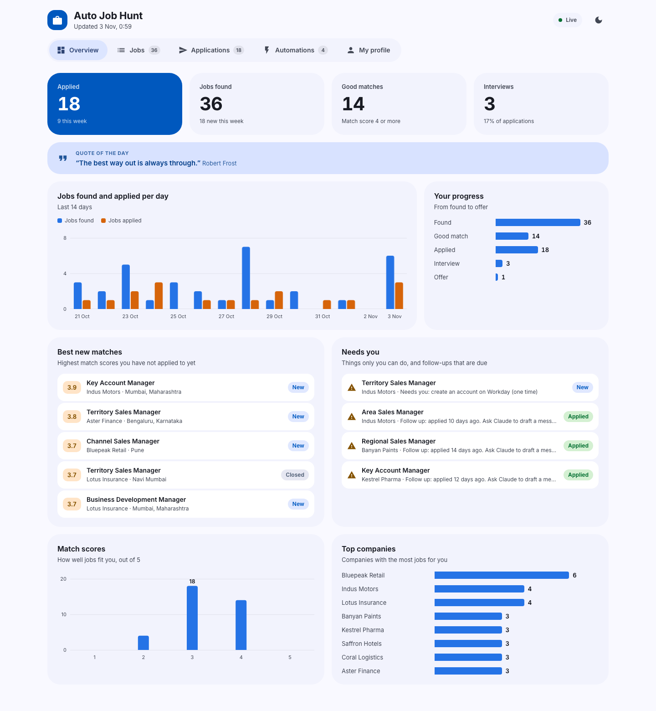
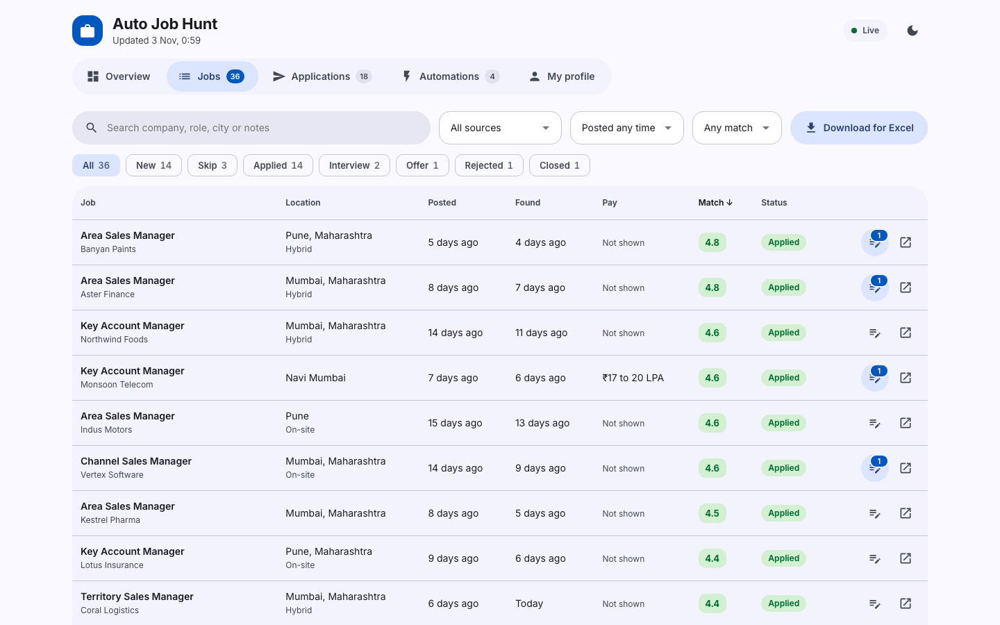
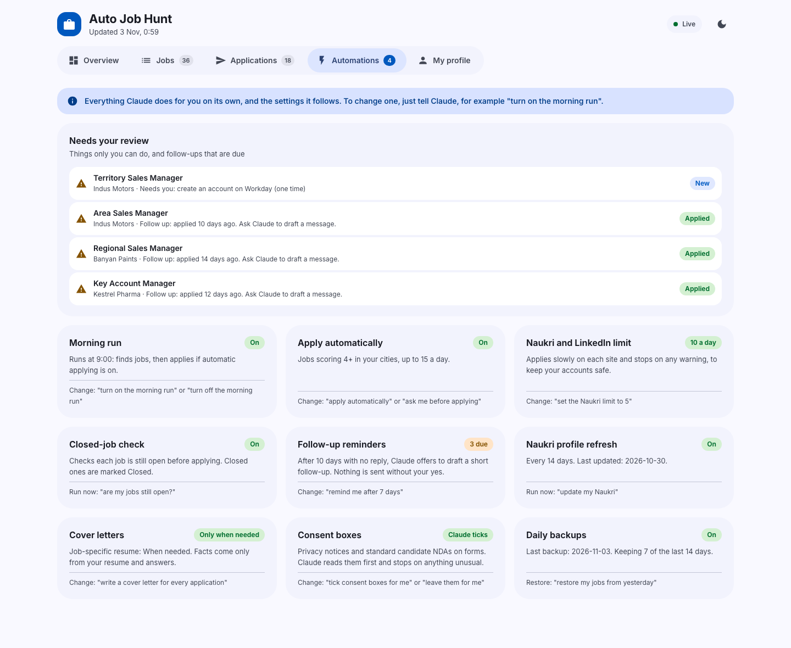
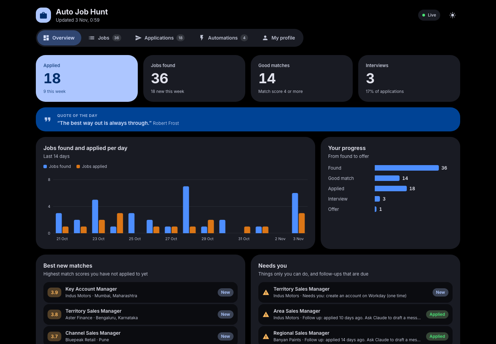
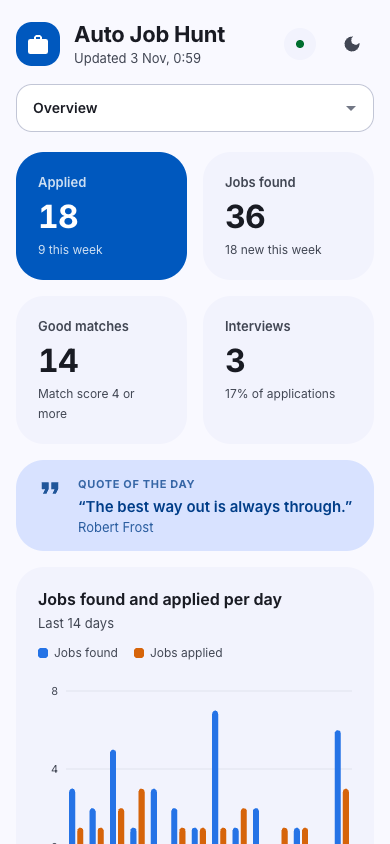

# Auto Job Hunt

A Claude plugin that runs your job search for you. No tech skills needed.

You answer a few questions once. After that you just say **"start"**: Claude finds jobs on company career pages, Naukri and LinkedIn, checks each one against what you want, writes a cover letter or a job-specific resume when needed, applies, and shows everything on a dashboard in your browser.

Built for people in India (sales, operations, HR, finance, tech and more), and it works for any role.



<sub>All screenshots use made-up demo data.</sub>

---

## Contents

- [What it does](#what-it-does)
- [Screenshots](#screenshots)
- [Setup for everyone (no tech skills)](#setup-for-everyone-no-tech-skills)
- [Setup for developers](#setup-for-developers)
- [How to use it](#how-to-use-it)
- [The dashboard](#the-dashboard)
- [Automations and settings](#automations-and-settings)
- [Safety rules](#safety-rules)
- [Where your data lives](#where-your-data-lives)
- [If something goes wrong](#if-something-goes-wrong)
- [Update or remove](#update-or-remove)
- [For developers](#for-developers)

---

## What it does

**Gets to know you**
- Asks for your resume, cities, job titles, salary (current, expected and the minimum you accept), notice period and a few rules. Suggests more job titles you may have missed.
- Offers to review your resume, asks about results and promotions that are missing from it, and builds a cleaner version. Can also make a longer CV.

**Finds jobs**
- About 100 companies with public job boards (tech, tech sales and sales: Paytm, Swiggy, Airwallex, ZoomInfo, Bosch, Databricks, MongoDB and more) plus the Tata group (Tanishq, Croma, Westside and others) searched by name.
- Naukri and LinkedIn, using your own logged-in Chrome.
- Skips duplicates (the same job on Naukri, LinkedIn and the company site counts once).
- Gives every job a match score from 1 to 5 with a one-line reason, and skips jobs in the wrong city or below your minimum pay.

**Applies**
- Company forms (Greenhouse, Lever, Ashby, SmartRecruiters and others), LinkedIn Easy Apply, LinkedIn jobs that apply on the company's own site, and Naukri.
- Writes a cover letter and a job-specific resume from the job description when a job needs one, using only facts from your resume and answers, and checks every number.
- Checks each job is still open before applying, never applies twice, and asks you whenever it does not know an answer.

**Keeps you going**
- A dashboard with your numbers, charts, every job, your notes, and a quote of the day.
- Follow-up reminders after 10 days with no reply, with a draft message you approve.
- Referral requests when you know someone at a company you are applying to.
- Interview prep: company research, likely questions with answers from your own experience, a salary answer and practice.
- Offer help: compares offers and drafts a polite negotiation reply.
- Keeps your Naukri profile fresh every 14 days.
- Talks in plain English, or in Hindi or Hinglish if you write that way.

---

## Screenshots

| Jobs, with filters and notes | Automations and settings |
|---|---|
|  |  |

| Dark mode | On a phone |
|---|---|
|  |  |

---

## Setup for everyone (no tech skills)

About 15 minutes, once. You need a Mac and a paid Claude plan.

1. **Install the Claude app.** Download it from [claude.com/download](https://claude.com/download), open it and sign in.
2. **Download this project.** On this page, click the green **Code** button, then **Download ZIP**. Open your **Downloads** folder and double-click the ZIP file to unzip it. Move the new **auto-job-hunt-main** folder into your **Documents** folder.
3. **Open it in Claude.** In the Claude app, open the **Code** tab, start a new session and choose the **auto-job-hunt-main** folder.
4. **Type:** `setup for me`

   Claude installs everything it needs (Node.js, the plugin, your Auto Job Hunt folder) and opens the Chrome extension page. You only do two things yourself:
   - type your Mac password when the Mac asks for it,
   - click **Add to Chrome** for the Claude extension, then sign in with your Claude account.
5. **Log in to Naukri and LinkedIn in Chrome** yourself, as you normally do.
6. **Start.** Start a new Claude session in the **Documents/Auto Job Hunt** folder and type: `start`

Claude asks its questions the first time, then searches and applies. Next time, `start` skips the questions.

> Note for Claude: if a user asks you to set this project up, follow the "Setup for me" section of `CLAUDE.md` in this folder.

---

## Setup for developers

```bash
git clone https://github.com/singhgautam7/auto-job-hunt.git ~/auto-job-hunt
```

```bash
brew install node    # Node.js 18 or newer; or install the LTS from nodejs.org
```

```bash
bash ~/auto-job-hunt/install.sh
```

```bash
cd ~/Documents/"Auto Job Hunt" && claude
```

Then type `start`. Also install the [Claude extension for Chrome](https://chromewebstore.google.com/detail/claude/fcoeoabgfenejglbffodgkkbkcdhcgfn) and log in to Naukri and LinkedIn there.

`install.sh` registers this folder as a local plugin marketplace and installs the plugin from it, so keep the folder where it is. Running it again updates the plugin.

---

## How to use it

Open Claude in your **Documents/Auto Job Hunt** folder and say what you want, in your own words.

| Say | What happens |
|---|---|
| `start` (or "start hunt", "job hunt") | Questions if not answered yet, then finds jobs, then applies |
| `find jobs` | Searches and scores, applies only if automatic applying is on |
| `apply to the top 5`, `apply to job 12` | Writes any documents needed, fills the forms and submits |
| `review my resume`, `make my CV` | Honest review, missing results, a cleaner resume or a longer CV |
| `write a cover letter for job 12` | Cover letter and, if needed, a job-specific resume |
| `update my Naukri`, `update my LinkedIn` | Shows the planned profile changes, makes them after your yes |
| `are my jobs still open?` | Checks every job and marks closed ones |
| `I have an interview at Zscaler` | Prep sheet, likely questions and answers, practice |
| `I got an offer from X` | Compares offers, drafts a negotiation reply if you want |
| `turn on the morning run` | Searches (and applies, if on) every morning at 9 |
| `check my setup` | Health check with plain-English fixes |
| `open my dashboard` | Starts the dashboard and gives you the link |

---

## The dashboard

It opens by itself when a chat starts. Click **http://localhost:4747** in any Claude reply, or double-click **Open Dashboard** in your Auto Job Hunt folder. It runs only on your computer. Bookmark it.

| Tab | What you see |
|---|---|
| **Overview** | Applied, jobs found, good matches, interviews; quote of the day; jobs found and applied per day; your progress; best new matches; things that need you |
| **Jobs** | Every job with search, filters (several statuses at once, source, posted date, match), sorting, a badge on jobs with notes, and **Download for Excel** |
| **Applications** | Applications per day, where you applied, and every application with its date and resume |
| **Automations** | What Claude does on its own and every setting, plus everything that needs your review |
| **My profile** | The answers Claude uses for every form |

Click any job for its details, the reason for its score, and your notes. The dashboard is for viewing; to change anything, ask Claude. It works on a phone screen and in dark mode.

---

## Automations and settings

Everything below shows on the **Automations** tab. To change one, just tell Claude, for example "remind me after 7 days".

| Setting | Default | What it does |
|---|---|---|
| Morning run | Off | Every morning at 9, finds jobs and applies if automatic applying is on. Works while the Mac is on and the Claude app is open. |
| Apply automatically | Your choice | Applies right away to jobs scoring 4 or more, in your cities, not below your minimum pay when shown |
| Max applications per day | 20 | Overall daily limit |
| Naukri and LinkedIn limit | 10 a day each | Applies slowly and stops on any warning, to keep your accounts safe |
| Closed-job check | On | Checks each job is still open before applying |
| Follow up after | 10 days | Then offers a short follow-up message for your approval |
| Naukri refresh | Every 14 days | Offers to refresh your Naukri profile |
| Cover letters | Only when needed | Or for every application |
| Job-specific resume | When needed | Made from the job description and your real facts |
| Consent boxes | Your choice | Claude ticks privacy notices and standard NDAs after reading them, or leaves them for you |
| Daily backups | On | A copy of your job list and profile each day, kept for 14 days |

---

## Safety rules

- **Never invents facts.** Resumes, cover letters and form answers use only your resume, your CV and what you told Claude. Unknown answers are asked, never guessed.
- **Never types your passwords or OTPs, never creates accounts, never solves CAPTCHAs.** When a site needs one, the job is marked "Needs you".
- **Submits only when you allow it:** right away if you turned on automatic applying (within your limits), otherwise after your yes.
- **Never sends emails or messages** (follow-ups, referrals, negotiation) without your yes for that message.
- **Respects your limits:** cities, minimum pay, companies to avoid, daily caps.
- **Stops at once** on any "unusual activity" or "verify you are human" warning.
- **Never clicks Submit twice** without a visible error, so nothing is sent twice.

Naukri and LinkedIn do not allow automatic tools and can restrict accounts that move too fast. The daily caps and slow pace lower that risk; they do not remove it.

---

## Where your data lives

Everything stays on your computer, in **Documents/Auto Job Hunt**:

| File or folder | What it holds |
|---|---|
| `profile.md` | Your answers, rules and settings, and saved answers to form questions |
| `jobs.md` | Every job found, its score, status and your notes |
| `resumes/`, `letters/`, `interviews/` | Your resumes and CV, cover letters, interview prep sheets |
| `.backups/` | Daily copies of `jobs.md` and `profile.md` |
| `app/` | The finder and dashboard, updated automatically when the plugin updates |

---

## If something goes wrong

- **Not sure what is wrong:** say `check my setup`. Claude runs a health check and tells you what to fix.
- **Dashboard does not open:** start a chat in your Auto Job Hunt folder, or double-click **Open Dashboard**.
- **Naukri or LinkedIn not working:** open Chrome, click the Claude icon in the toolbar and check you are signed in; check you are logged in to Naukri and LinkedIn.
- **"Needs you" on a job:** a site wanted a login, an account, a CAPTCHA or an answer only you know. Say `start` and Claude asks you what it needs.
- **Lost or broken job list:** say `restore my jobs from yesterday`.
- **Anything else:** tell Claude what you see, in your own words.

---

## Update or remove

**Update.** Downloaded the ZIP: download the new ZIP, unzip it, open Claude in that folder and say `setup for me`. Used git:

```bash
cd ~/auto-job-hunt && git pull && bash install.sh
```

Your Auto Job Hunt folder picks up the new version the next time you start a chat. Your data is never touched.

**Remove:**

```bash
claude plugin uninstall auto-job-hunt@auto-job-hunt
```

```bash
claude plugin marketplace remove auto-job-hunt
```

Your data stays in **Documents/Auto Job Hunt** until you delete that folder yourself.

---

## For developers

No dependencies: everything runs on Node.js 18+ and the Chrome already on the computer.

| Path | Purpose |
|---|---|
| `CLAUDE.md` | Rules Claude follows (copied into each user's folder) |
| `skills/` | `hunt`, `setup`, `find-jobs`, `apply`, `tailor`, `resume`, `interview-prep`, `job-site-profile`, `dashboard` |
| `scripts/scan.mjs` | Job finder for Greenhouse, Lever, Ashby and SmartRecruiters boards; `--add` for jobs found on Naukri or LinkedIn; `--check` to test a company |
| `scripts/check-live.mjs` | Checks whether postings are still open |
| `scripts/dashboard.mjs` | Local dashboard server (reads and safely writes `jobs.md`) |
| `scripts/make-pdf.mjs` | HTML to PDF with headless Chrome |
| `scripts/start-dashboard.mjs` | Start-up hook: updates the user's `app/`, daily backup, starts the dashboard |
| `scripts/doctor.mjs` | Health check |
| `templates/` | Dashboard page, resume and cover letter templates, files for a new user's folder |
| `companies.json` | Built-in company list |
| `hooks/hooks.json` | Runs `start-dashboard.mjs` when a chat starts |

```bash
bash test.sh                  # every self-test
```

```bash
claude plugin validate .      # plugin structure
```

---

## Credits

Job board scanning approach inspired by [career-ops](https://github.com/career-ops-hq/career-ops) (MIT). Dashboard ideas inspired by [dossier](https://github.com/AienTech/dossier).

MIT License.
